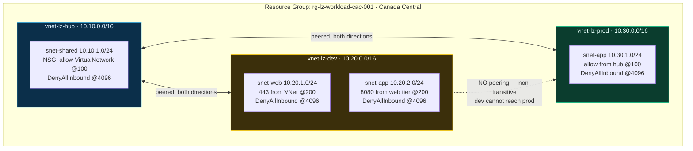
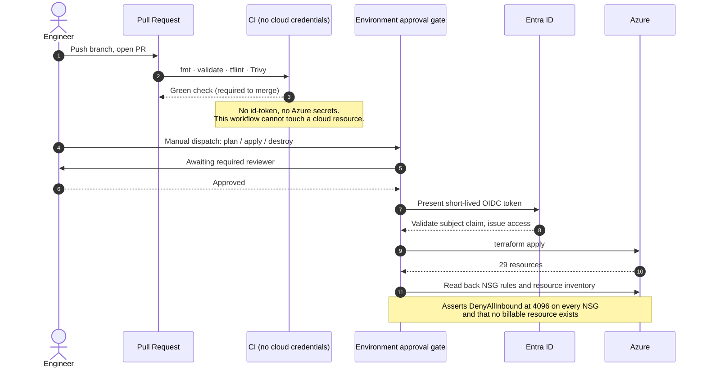
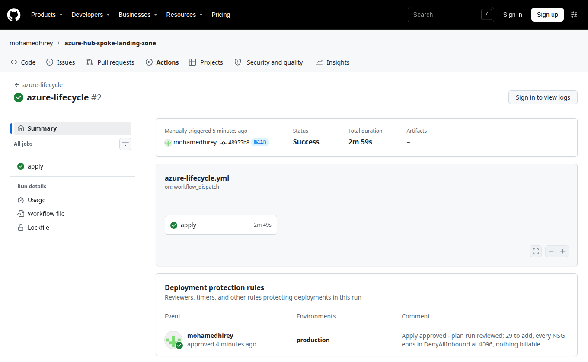

# Azure Hub-and-Spoke Landing Zone

[](https://github.com/mohamedhirey/azure-hub-spoke-landing-zone/actions/workflows/ci.yml)
[](#)
[](#)
[](#)
[](#)
[](#)

A production-shaped Azure network landing zone: hub-and-spoke topology, default-deny network security groups, remote state that no storage account key can open, and a secretless OIDC deployment pipeline. Built with Terraform. Every deployment is verified against live Azure and torn down in the same session.

> **Evidence status:** Deployed and verified on 19 November 2026 (UTC), then removed. No Azure resource remains.
> The pipeline in this repository did all three: [plan](https://github.com/mohamedhirey/azure-hub-spoke-landing-zone/actions/runs/44460878382) · [apply](https://github.com/mohamedhirey/azure-hub-spoke-landing-zone/actions/runs/44461006767) · [destroy](https://github.com/mohamedhirey/azure-hub-spoke-landing-zone/actions/runs/44461612790). The captured proof is in [`docs/evidence/`](docs/evidence/README.md).

**Author:** Mohamed Hirey — Azure Cloud Engineer · [linkedin.com/in/mohamedhirey](https://linkedin.com/in/mohamedhirey)

Companion project: [**Azure Secure Web App**](https://github.com/mohamedhirey/azure-secure-web-app) covers what runs on top of a network like this one: platform services, managed identity, private connectivity and monitoring.

---

## The problem this solves

A platform team is provisioning Azure networks by hand through the portal. The consequences are the ones every organisation hits in the same order:

- **Configuration drift** between environments that nobody can reconstruct or explain.
- **Accidental exposure** — a network security group with an allow rule numbered above the default deny looks correct in the portal and silently permits everything.
- **No audit trail.** Nobody can say who changed what, when, or why, which fails the evidence requirement in every compliance framework the business is subject to.
- **Standing credentials.** A service principal client secret sits in CI for years because rotating it means coordinating a maintenance window.

**The delivery:** the entire network topology as reviewed, tested, version-controlled code; a security posture that fails closed by construction; a deployment identity that holds no long-lived secret and no standing permission; and a verification step that reads live Azure rather than trusting Terraform's own report.

---

## Architecture



**Three VNets, not two.** Peering in Azure is non-transitive: `dev → hub → prod` does not route. That isolation only means something if both spokes actually exist and there is still no path between them. `allow_forwarded_traffic = false` on every peering enforces the same property at the data plane.

**Nothing reaches Azure unvalidated.** Every module, unit test and pipeline check runs offline first, so Azure only ever sees code that has already been checked.

---

## Deployment pipeline



---

## Evidence

Deployed to a real subscription on 19 November 2026 (UTC), verified, and removed. Full index: [`docs/evidence/`](docs/evidence/README.md).



| Claim | Proof |
|---|---|
| The pipeline signs in with no secret | The [apply run](https://github.com/mohamedhirey/azure-hub-spoke-landing-zone/actions/runs/44461006767) log prints the federated token's subject and `Azure CLI login succeeds by using OIDC`. The app registration held 0 client secrets: [`02-identity-oidc.txt`](docs/evidence/02-identity-oidc.txt) |
| State cannot be read with an account key | Refused with `KeyBasedAuthenticationNotPermitted`: [`03-keyless-remote-state.txt`](docs/evidence/03-keyless-remote-state.txt) |
| Every NSG fails closed | `DenyAllInbound` at 4096 on all four, read back from Azure: [`06-live-azure-verification.txt`](docs/evidence/06-live-azure-verification.txt) |
| Dev cannot reach prod | Four peerings, all `Connected`, none between the spokes: [`06-live-azure-verification.txt`](docs/evidence/06-live-azure-verification.txt) |
| The tests can fail | Break the rule, watch 2 of 4 fail, restore: [`01-unit-tests.txt`](docs/evidence/01-unit-tests.txt) |
| Nothing was left behind | 0 resources, roles, app registrations or secrets: [`07-teardown.txt`](docs/evidence/07-teardown.txt) |

---

## Engineering decisions made

| Decision | Reasoning |
|---|---|
| **Catch-all deny at priority 4096, not 100** | Azure evaluates NSG rules lowest-number-first and stops at the first match. A deny at 100 makes every later allow unreachable — and it looks correct. At 4096, the highest priority number Azure accepts and so the last custom rule evaluated, any allow added later is evaluated first and a broken allow fails **closed**. |
| **A `validation` block enforces that ordering** | The rule is not written in a comment and hoped for. `modules/nsg/variables.tf` rejects any tier rule numbered at or above 4096 at plan time. A unit test asserts the constraint, and a fourth test asserts that the validation itself fires. |
| **Bootstrap is a separate root module with local state** | If the storage account holding state were declared alongside the network, a `destroy` could delete the state file describing the destroy it is halfway through. Bootstrap owns both resource groups, so the workload module cannot reach upward and delete its own backend. This is also why no `prevent_destroy` lock is needed anywhere. |
| **`shared_access_key_enabled = false`** | The state account refuses Shared Key authorization: its account keys, and any SAS token signed with them, do not work. Blob access is Entra ID data-plane RBAC only. That is an enforced property, not a policy document. |
| **State account reachable by identity, not by network** | GitHub-hosted runners have no fixed address, so a storage firewall default of Deny would lock the pipeline out of its own state. The scanner flags this (Trivy `AZU-0012`, critical) and the finding is accepted inline in `bootstrap/main.tf` with the reason beside it, not hidden or downgraded. Closing the network path means a private endpoint and a self-hosted runner. |
| **OIDC federation, no client secret** | GitHub mints a short-lived token per run; Entra validates it against a federated credential whose subject is pinned to one repository *and one environment*. The repository is named by its immutable ID, so a renamed or re-created repository cannot inherit the trust. Nothing outside the approved environment can obtain a token. |
| **`Network Contributor` at resource-group scope** | Not `Contributor` at subscription scope. The pipeline only ever touches networking inside one resource group, so that is the only thing it can do. Roles are granted the day of deployment and revoked the same day. |
| **CI carries no Azure credentials at all** | The repository is public. Formatting, validation, linting and IaC scanning need no cloud access, so they are given none. Only manual dispatch, behind an approval gate, ever authenticates. |
| **Verification reads live Azure** | A green `apply` proves Terraform succeeded, not that the posture is correct. The pipeline queries Azure for every NSG's highest-priority rule and fails if it is not `Deny` at 4096 — then fails again if any VM, public IP, NAT gateway, firewall or VPN gateway is found. |
| **`for_each` everywhere except one toggle** | `count` addresses by index, so removing a middle item shifts every later index and Terraform destroys and recreates them. `for_each` keys by a stable string. `count` appears exactly once, on a genuine 0-or-1 rule toggle. |
| **Zero standing cost** | No compute, no public IP, no gateway, no metered service. VNets, subnets, NSGs and peerings are free to exist. The environment is torn down in the same session it is deployed. |

---

## Repository layout

```
azure-hub-spoke-landing-zone/
├── README.md                    This file — architecture and rationale
├── GUIDE.md                     Deployment guide: 22 steps, prerequisites to teardown
├── REFERENCE.md                 Naming, tags, NSG priorities, troubleshooting table
│
├── bootstrap/                   Root module 1 — local state, run by hand
│   ├── main.tf                  State + workload resource groups, storage account with key access off
│   ├── variables.tf  outputs.tf  versions.tf
│   └── terraform.tfvars.example
│
├── envs/prod/                   Root module 2 — remote state, run by the pipeline
│   ├── main.tf                  Hub, spokes, NSG associations, peerings
│   ├── variables.tf  outputs.tf  versions.tf
│
├── modules/
│   ├── network/                 VNet + subnets, for_each keyed by subnet name
│   ├── nsg/                     NSG + ordered rules, with priority validation
│   │   └── tests/rule_order.tftest.hcl    4 unit tests, plan-only
│   └── peering/                 Both directions of one logical peering
│
├── scripts/
│   ├── setup-linux.sh           Installs terraform, az, gh, git, tflint (Debian family)
│   └── validate.sh              fmt + validate + tflint + unit tests, one command
│
├── .github/workflows/
│   ├── ci.yml                   fmt, validate, tflint, Trivy — no cloud credentials
│   └── azure-lifecycle.yml      plan/apply/destroy, OIDC, approval gate, live verification
│
└── docs/evidence/               Captured output and screenshots from the deployment, redacted
```

---

## Quick start

The full procedure, with a **Done when** check on every step, is in [`GUIDE.md`](GUIDE.md).

```bash
# One-time tool install on Debian, Ubuntu, Mint or LMDE
chmod +x scripts/*.sh && ./scripts/setup-linux.sh

# Validate everything offline — no Azure connection is attempted
./scripts/validate.sh --no-test

# ...which is shorthand for:
terraform fmt -recursive
(cd bootstrap && terraform init -backend=false && terraform validate)
(cd envs/prod && terraform init -backend=false && terraform validate)

# Run the NSG unit tests (plan-only; creates nothing)
cd modules/nsg
terraform init -backend=false
export ARM_SUBSCRIPTION_ID=$(az account show --query id -o tsv)
terraform test        # expect: Success! 4 passed, 0 failed.
```

**Requirements:** Terraform 1.9 or later (CI and the recorded deployment use 1.16), Azure CLI, GitHub CLI, and an Azure subscription, with its spending limit on where it has one.

---

## What gets deployed

29 Terraform resources, all free to exist:

| Count | Resource |
|---|---|
| 3 | Virtual networks (hub, dev spoke, prod spoke) |
| 4 | Subnets |
| 4 | Network security groups, each with `DenyAllInbound` at 4096 |
| 10 | NSG rules: the catch-all deny and the hub allow on every group, plus two tier rules |
| 4 | Subnet-to-NSG associations |
| 4 | VNet peerings — two per spoke, hub-to-spoke and spoke-to-hub |

Zero virtual machines, zero public IP addresses, zero gateways, zero metered services.
