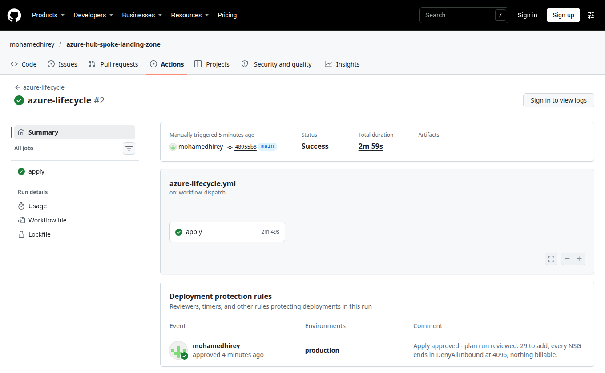
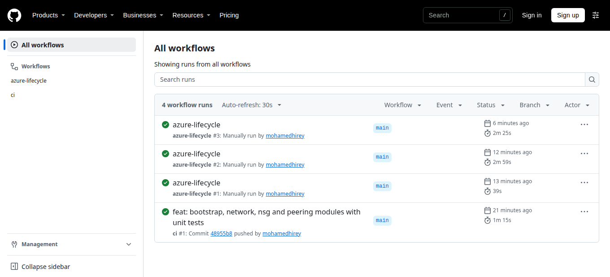

# Deployment evidence

This landing zone was deployed to a real Azure subscription, verified and removed again on **19 November 2026 (UTC)**. Everything in this folder was captured during that run.

It was the second run that day. The first found the four things listed at the end of this page, and each was corrected before this one.

Subscription, tenant and client IDs, the state storage account name and public addresses are redacted. Nothing else is edited.

## The pipeline runs

All three are public. Each one shows the `production` approval gate, the OIDC sign-in and the Terraform output.

| Run | What it did | Result |
|---|---|---|
| [plan](https://github.com/mohamedhirey/azure-hub-spoke-landing-zone/actions/runs/44460878382) | Signed in with OIDC, read the keyless remote state, planned | 29 to add |
| [apply](https://github.com/mohamedhirey/azure-hub-spoke-landing-zone/actions/runs/44461006767) | Created the network, then read it back from live Azure | 29 added, both posture checks passed |
| [destroy](https://github.com/mohamedhirey/azure-hub-spoke-landing-zone/actions/runs/44461612790) | Removed it through the same pipeline | 29 destroyed |

## What each file proves

| Claim | Proof |
|---|---|
| The NSG rule ordering is tested, and the test can fail | [`01-unit-tests.txt`](01-unit-tests.txt): 4 pass. With the catch-all deny moved to priority 100, 2 fail with the message written for them. Restored, 4 pass. |
| The pipeline holds no secret and exactly two narrow roles | [`02-identity-oidc.txt`](02-identity-oidc.txt): one federated credential, pinned to this repository's immutable ID and the `production` environment. 0 client secrets, 0 certificates, 0 Graph permissions. Network Contributor on one resource group, Storage Blob Data Contributor on one storage account. |
| Remote state cannot be reached with an account key | [`03-keyless-remote-state.txt`](03-keyless-remote-state.txt): an Entra ID sign-in lists the state blob. The same request with an account key is refused, `KeyBasedAuthenticationNotPermitted`. |
| The plan was read before anything was applied | [`04-pipeline-plan.txt`](04-pipeline-plan.txt) |
| The apply succeeded, and the pipeline then checked live Azure | [`05-pipeline-apply-and-verify.txt`](05-pipeline-apply-and-verify.txt) |
| The deployed network is the one in the design | [`06-live-azure-verification.txt`](06-live-azure-verification.txt): three VNets. Four peerings, all `Connected`, none between dev and prod. Every NSG ends in `DenyAllInbound` at 4096. Nothing in the group but VNets and NSGs. |
| Nothing was left behind | [`07-teardown.txt`](07-teardown.txt): 0 resources, 0 role assignments, 0 app registrations, 0 `rg-lz-*` groups, 0 repository secrets. Then the whole subscription: Azure's own `NetworkWatcherRG` removed, leaving 0 resource groups. |

Screenshots of the other two runs: [`pipeline-plan-run.png`](pipeline-plan-run.png), [`pipeline-destroy-run.png`](pipeline-destroy-run.png).

## What the first deployment found

Local validation and the unit tests passed before the first run. These only showed up against the real services, and each was corrected before the run recorded here.

1. **The plan was 29 resources, not 19.** The ten NSG rules are resources in their own right and had not been counted. The documents now say 29.
2. **GitHub's OIDC subject had changed shape.** Repositories created after 15 July 2026 issue `repo:OWNER@OWNER_ID/REPO@REPO_ID:...`, not `repo:OWNER/REPO:...`. A credential written the old way would have been rejected by Entra ID with no useful error. Step 12 of the guide asks GitHub for the prefix and does not assume it.
3. **The scanner's own action had moved.** The pinned `trivy-action` tag no longer existed upstream, so it is pinned to a commit. The current Trivy also raises a critical finding on the state storage account, `AZU-0012`, which is accepted inline in `bootstrap/main.tf` with the reasoning beside it.
4. **"Nothing left" was not quite true.** The teardown had checked this deployment's own resource groups. A check across the whole subscription found the `NetworkWatcherRG` that Azure creates by itself, and the app registration sitting in the directory's recycle bin. Step 21 of the guide now says where to look, and this run's teardown covers both.

## One thing still open

The workflows pin `actions/checkout@v4`, `hashicorp/setup-terraform@v3`, `azure/login@v2` and `terraform-linters/setup-tflint@v4`. These target Node.js 20, which GitHub now forces onto Node.js 24 with a warning on every run. They work, and both runs used them. Moving to the current majors is a small follow-up.
